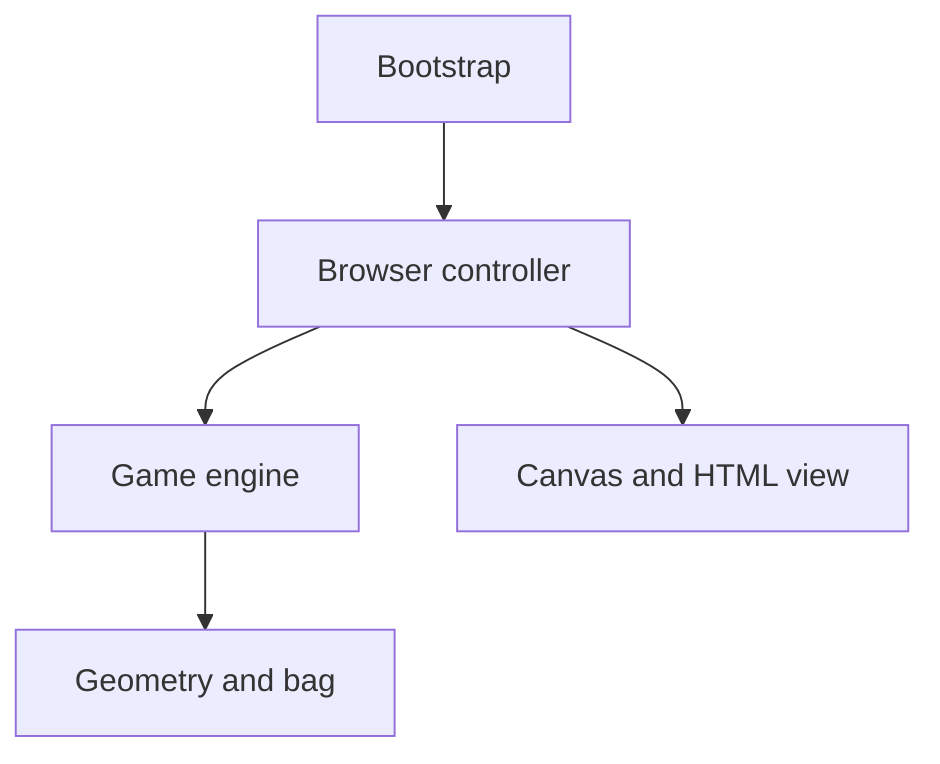

# Tetris architecture

## Context and decisions

The [project brief](PROJECT.md) defines a single-player TypeScript browser game with the complete classic and modern capability set. The application is a static client-side build with no runtime service dependency, persistence, or account system.

| Decision | Selected approach and rationale | Alternatives assessed |
| --- | --- | --- |
| Gameplay model | Deterministic synchronous engine with explicit state, actions, elapsed time, and injected randomness | DOM-owned rules couple correctness to browser events and make timing tests harder |
| Presentation | Canvas 2D board; HTML status, next/hold previews, controls, and lifecycle buttons | A DOM cell grid is viable but adds element/style churn; React adds a second state model and dependency without a required application workflow |
| Scheduling | Browser controller owns requestAnimationFrame, monotonic time, focus, and input dispatch | Engine-owned timers obscure pause and test control |
| Tooling | Vite with vanilla TypeScript, Vitest for rule tests, Playwright for browser acceptance | A game framework is unnecessary for a fixed falling-block board |

## Blocks and dependency direction

The engine owns authoritative game state: board, active/held/upcoming pieces, randomizer state, score, level, timers, and lifecycle. Geometry and randomization are cohesive engine collaborators. They have no DOM, Canvas, network, storage, wall-clock, or browser-timer dependencies.

The browser controller translates keyboard and lifecycle events into engine actions, advances the engine with elapsed active time, and requests rendering. It owns subscriptions and animation callbacks. The view consumes snapshots; it never moves pieces, computes a separate ghost position, or awards points. Bootstrap composes these blocks and supplies the production randomness adapter.

The view receives the engine's read-only snapshot through the controller. No reverse dependency from engine to view/controller is permitted. Snapshot ownership prevents a renderer or test consumer from mutating engine internals.

## Interaction and lifecycle

Input actions and elapsed-time advancement execute synchronously on the browser thread. A transition completes before the next action or render. The controller cancels held-key repeat and its time baseline on pause, focus loss, or disposal. Visibility loss pauses an active game; resumption is explicit. The engine has no asynchronous side effects.

The engine produces the active and ghost cells from shared placement rules, including rotation and collision handling. Piece locking, row removal, score/level updates, next spawn, and top-out form an ordered transition. Hold and hard drop enter through the same action boundary. SPEC owns their precise semantics and timing.

A new session creates fresh game state. Restart replaces the session while reusing the application/controller bindings; it must not register another animation loop or duplicate event listeners. The composition root can dispose the application and release every browser resource it owns.

## Data and failure boundaries

A board has 20 rows and 10 columns with empty cells or tetromino identifiers. Active pieces are separate from settled cells until lock. Engine snapshots expose lifecycle, score, level, cleared-line count, active/ghost positions, hold availability, and next piece. No user configuration or saved-state schema is required.

Blocked gameplay actions are ordinary rejected transitions. Invalid programmer inputs, such as non-finite time or invalid random samples, are explicit errors handled at the engine boundary. Fatal browser initialization failure presents a readable message rather than leaving an inert unexplained board. Detailed error contracts belong to SPEC.

## Verification and delivery constraints

Engine tests control time and randomness and cover geometry, bag boundaries, locking, clearing, scoring, hold, ghost, hard drop, and top-out. Browser acceptance exercises actual keyboard events, focus, rendering, lifecycle buttons, and disposal across Playwright Chromium, Firefox, and WebKit. Canvas checks include observed rendering, not only engine snapshots.

An isolated test harness may compose the actual application with deterministic fixtures; it is excluded from the production build. The shipped application has no debug state mutation endpoint or test-only globals. Production build checks verify assets and absence of harness/debug surfaces.

Use Node.js 22.12 or newer within an officially supported Node release and a mutually compatible Vite/Vitest/Playwright package set. Exact versions and the lockfile are established and validated during implementation environment setup, not guessed here. Shell instructions must work with Windows CMD and avoid a PowerShell dependency. The current preparation environment reports Node 24.19.0; product tooling and browsers have not been installed or validated.

## Sources and navigation

Official tooling documentation inspected on 2026-10-17: [Vite getting started](https://vite.dev/guide/), [Vitest getting started](https://vitest.dev/guide/), and [Playwright browsers](https://playwright.dev/docs/browsers). These support tool selection; they do not establish installation or compatibility in this repository.

Logical responsibilities and verification seams are defined in DECOMPOSITION when that checkpoint is completed. SPEC owns behavioral contracts, PLAN owns delivery boundaries, and layout owns physical paths.
